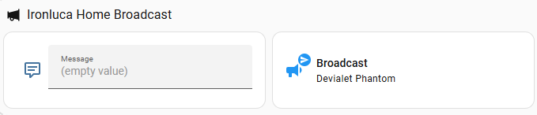
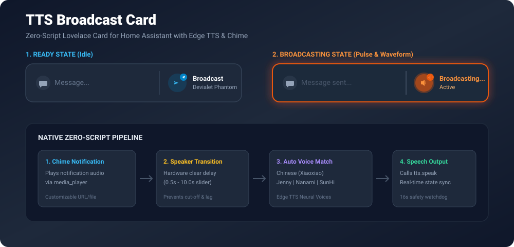
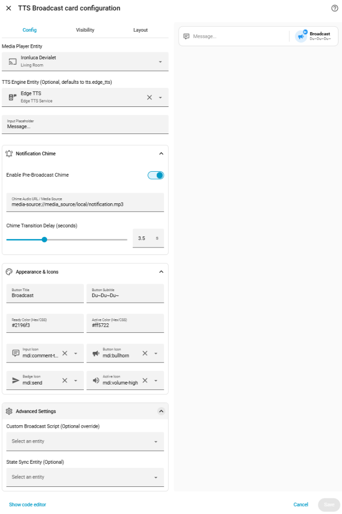

# TTS Broadcast Card

<p align="center">
  <a href="https://github.com/hacs/default"></a>
  <a href="https://github.com/lucayunxiao/tts-broadcast-card/releases"></a>
  <a href="LICENSE"></a>
  
</p>

<p align="center">
  <b>A modern, zero-configuration reactive TTS broadcast card for Home Assistant Lovelace</b><br/>
  Featuring native chime playback, interactive volume control, hardware volume delegation, auto-unmute, UPnP session release, Microsoft Edge TTS neural multi-language auto-detection, visual GUI form editor, and real-time state feedback.
</p>

<p align="center">
  <a href="README.md"><b>English</b></a> | <a href="README_zh.md"><b>简体中文</b></a>
</p>

---

## 📸 Preview



<p align="center">
  
</p>

---

## ✨ Features

- ⚡ **Zero-Script Out-of-the-Box**: Orchestrates the entire broadcast pipeline directly from frontend Web Components. No complex backend YAML scripts, automations, or template helpers required!
- 🔊 **Interactive In-Card Volume Control**: Adjust broadcast volume directly from the card via an interactive volume pill and mini slider. Click the pill to toggle mute/restore with persistent memory. Chosen volume is automatically remembered per speaker in browser local storage.
- 🎛️ **Hardware Volume Delegation (`volume_entity`)**: Seamlessly decouple UPnP/DLNA media streaming from native hardware amplifier volume controls (ideal for Devialet Phantom, KEF, Sonos, or custom AV receivers with separate controller and player entities).
- 🔈 **Smart Auto-Unmute Before Broadcast (`auto_unmute`)**: Automatically sends an un-mute command to the hardware volume entity before speech starts, ensuring critical announcements and security alerts are never missed.
- 🔁 **Smart Volume Restoration (`restore_volume`)**: Automatically captures the speaker's original volume (and mute status) before broadcasting, plays the message at the card's chosen slider volume, and restores the original volume when speech playback finishes. Features a built-in collision lock for rapid consecutive broadcasts to prevent overwriting saved volume.
- 🛑 **Intelligent Auto-Stop & Session Release (`auto_stop`)**: Releases UPnP/DLNA session locks after speech playback finishes so smart speakers (e.g. Devialet Phantom, Sonos) automatically switch back to TV Optical (TOSLink) or HDMI eARC inputs. Includes automatic `supported_features` bitmask detection (STOP vs PAUSE) to ensure zero 400 Bad Request errors.
- 🔔 **Pre-Broadcast Notification Chime**: Plays a chime/bell sound before speaking, with a configurable speaker transition buffer (`chime_delay`) to prevent audio cut-offs on DLNA, Google Cast, Sonos, or AirPlay speakers.
- 🌐 **Microsoft Edge TTS Neural Voice Auto-Detection**: Automatically detects input language and routes to native neural voices:
  - 🇨🇳 Chinese $\to$ `zh-CN-XiaoxiaoNeural` (晓晓)
  - 🇺🇸 English $\to$ `en-US-JennyNeural` (Jenny)
  - 🇯🇵 Japanese $\to$ `ja-JP-NanamiNeural` (Nanami / 七海)
  - 🇰🇷 Korean $\to$ `ko-KR-SunHiNeural` (SunHi / 善喜)
- 📱 **Mobile Screen Optimization**: Responsive layout adjustments for mobile screens (`<= 480px`), providing a compact volume pill and slider.
- ⚡ **IME Composition & Rapid Re-entrancy Protection**: Built-in support for Chinese/Japanese IME (`isComposing` guard prevents accidental Enter sends while selecting candidate words), async pipeline cancellation (`_sessionId`) to abort stale broadcasts on double-sends, and dynamic duration watchdogs.
- 🎛️ **Full Graphical Visual Configurator**: Clean 5-tier expandable `<ha-form>` editor (Core Settings, Volume & Sound Control, Notification Chime, Appearance & Icons, Advanced Settings).
- 🛡️ **Debounced State & 18s Safety Watchdog**: Dynamic pulse animation during playback, real-time media player state tracking, and an 18-second failsafe safety reset watchdog.
- 🔄 **Backward Compatible**: Supports optional custom script delegation and `input_text` state synchronization for power users.

---

## 📦 Prerequisites (Recommended)

### 🎙️ Microsoft Edge TTS Integration

While this card can work with any Home Assistant TTS entity (`tts.piper`, `tts.google_translate`, `tts.cloud`, etc.), it is **specifically optimized for Microsoft Edge TTS** (`tts.edge_tts`). 

Installing the [hass-edge-tts](https://github.com/hasscc/hass-edge-tts) integration grants you access to Microsoft's high-fidelity neural voices across 400+ voices completely **free without cloud subscription fees**:

1. Open **HACS** in Home Assistant.
2. Search for **Edge TTS** and click **Download**.
3. Restart Home Assistant and add **Edge TTS** in **Settings > Devices & Services > Add Integration**.

> [!NOTE]
> If you choose to use another TTS provider (e.g. `tts.piper` or `tts.google_translate`), you can simply select your engine in the card's visual editor under **TTS Engine Entity**. The card will gracefully fallback to standard TTS speak calls.

---

## 🚀 Installation

### Method 1: Via HACS (Recommended)

1. Open **HACS** in your Home Assistant dashboard.
2. Search for `TTS Broadcast Card` in the search bar.
3. Click on the card and select **Download**.
4. Refresh your browser window.

[](https://my.home-assistant.io/redirect/hacs_repository/?owner=lucayunxiao&repository=tts-broadcast-card&category=plugin)

> [!TIP]
> **For Lovelace YAML Mode (`mode: yaml`) Users**:  
> If your Home Assistant dashboard is configured in pure YAML mode, add the following resource definition to your `ui-lovelace.yaml` or `configuration.yaml` after downloading via HACS, then restart Home Assistant:
> ```yaml
> lovelace:
>   mode: yaml
>   resources:
>     - url: /hacsfiles/tts-broadcast-card/tts-broadcast-card.js
>       type: module
> ```

### Method 2: Manual Installation

1. Download [`dist/tts-broadcast-card.js`](https://raw.githubusercontent.com/lucayunxiao/tts-broadcast-card/main/dist/tts-broadcast-card.js).
2. Copy `tts-broadcast-card.js` into your Home Assistant `<config>/www/` directory.
3. In Home Assistant, navigate to **Settings > Dashboards > Three dots (top-right) > Resources**.
4. Click **Add Resource**, set URL to `/local/tts-broadcast-card.js?v=1.1.0` and Resource type to `JavaScript Module`.
5. Refresh your browser cache.

---

## 🛠️ Configuration

### Graphical User Interface (UI Editor)

<p align="center">
  
</p>

Add a new card to your dashboard and select **TTS Broadcast Card**. The visual editor is organized into 5 collapsible sections:

1. **Core Settings**:
   - `media_player` (*Required*): Target speaker entity for broadcast playback.
   - `tts_entity` (*Optional*): TTS engine entity (defaults to `tts.edge_tts`).
   - `placeholder` (*Optional*): Input placeholder text (default: `Message...`).
2. **Volume & Sound Control**:
   - `volume_level`: Default broadcast volume slider (0% ~ 100%, step 5, default 40%).
   - `show_volume_control`: Toggle in-card interactive volume pill and slider.
   - `restore_volume`: Automatically capture and restore original volume (and mute state) after playback.
   - `volume_entity` (*Optional*): Hardware volume entity override (e.g. amplifier or Devialet controller).
   - `auto_unmute`: Automatically un-mute speaker before broadcast.
   - `auto_stop`: Release UPnP/DLNA session after speech so TV Optical / HDMI eARC restores automatically.
   - `stop_entity` (*Optional*): Stop target entity override for Auto-Stop session release.
3. **Notification Chime**:
   - `chime_enabled`: Toggle pre-broadcast chime audio on/off.
   - `chime_url`: URL or media path (`media-source://...`, `/local/...`, or HTTP URL).
   - `chime_delay`: Slider (0.5s ~ 10.0s) to allow hardware audio buffer to flush before TTS speaks.
4. **Appearance & Icons**:
   - `title` & `subtitle`: Button header text.
   - `ready_color` & `active_color`: Hex or CSS colors for idle and broadcasting states.
   - `input_icon`, `button_icon`, `badge_icon`, `active_icon`: Custom MDI icons.
5. **Advanced Settings**:
   - `script`: Optional custom backend script override.
   - `input_text`: Optional text helper entity to sync message contents.

---

### YAML Example

```yaml
type: custom:tts-broadcast-card
media_player: media_player.living_room_player
volume_entity: media_player.living_room_controller # Optional: separate amplifier / controller entity
volume_level: 45
show_volume_control: true
restore_volume: true # Optional: restore original speaker volume after broadcast
auto_unmute: true
auto_stop: true
tts_entity: tts.edge_tts
placeholder: "Type a message to broadcast..."
chime_enabled: true
chime_url: media-source://media_source/local/notification.mp3
chime_delay: 3.5
title: "Broadcast"
subtitle: "Living Room"
ready_color: "#2196f3"
active_color: "#ff5722"
input_icon: mdi:comment-text-outline
button_icon: mdi:bullhorn
badge_icon: mdi:send
active_icon: mdi:volume-high
```

---

## 📋 Configuration Options

| Option | Type | Default | Description |
| :--- | :--- | :--- | :--- |
| `media_player` | string | **Required** | Entity ID of target speaker (`media_player.xxx`). |
| `tts_entity` | string | `tts.edge_tts` | Entity ID of TTS engine. |
| `placeholder` | string | `Message...` | Text box placeholder text. |
| `volume_level` | number | `40` | Default broadcast volume percentage (0 - 100%). |
| `show_volume_control` | boolean | `true` | Show interactive volume pill and slider directly on the card. |
| `restore_volume` | boolean | `false` | Automatically restore speaker's original volume and prior mute status after broadcast finishes. |
| `volume_entity` | string | *None* | Optional hardware volume entity ID for dual-entity speaker setups. |
| `auto_unmute` | boolean | `true` | Automatically un-mute speaker before broadcasting. |
| `auto_stop` | boolean | `true` | Automatically release UPnP session after playback to restore TV optical sound. |
| `stop_entity` | string | *None* | Optional override entity for Auto-Stop session release (defaults to volume_entity or media_player). |
| `chime_enabled` | boolean | `true` | Whether to play a pre-broadcast notification sound. |
| `chime_url` | string | `media-source://media_source/local/notification.mp3` | Audio URL or path for notification chime. |
| `chime_delay` | number | `3.5` | Transition delay (in seconds) between chime and speech. |
| `title` | string | `Broadcast` | Primary label on action button. |
| `subtitle` | string | Friendly name | Secondary label on button (defaults to speaker name). |
| `ready_color` | string | `#2196f3` | Accent color when card is idle. |
| `active_color` | string | `#ff5722` | Glow and accent color when broadcasting. |
| `input_icon` | string | `mdi:comment-text-outline` | Icon inside input text box. |
| `button_icon` | string | `mdi:bullhorn` | Idle state icon. |
| `badge_icon` | string | `mdi:send` | Idle state badge icon. |
| `active_icon` | string | `mdi:volume-high` | Active broadcasting icon. |
| `script` | string | *None* | Advanced: Custom script entity to override native pipeline. |
| `input_text` | string | *None* | Advanced: Optional helper entity to mirror message text. |

---

## ❓ FAQ & Troubleshooting

<details>
<summary><b>1. Why does my speaker clip off the first word of the announcement?</b></summary>
Network and wireless speakers (Chromecast, DLNA, AirPlay) often need a short warmup period when switching from idle or playing chime to speech. Increase <code>chime_delay</code> (e.g. to 3.5s - 4.5s) in card configuration to give the speaker adequate buffer time.
</details>

<details>
<summary><b>2. Why doesn't my Devialet / Sonos speaker switch back to TV Optical sound after TTS?</b></summary>
When streaming TTS or chime via UPnP/DLNA, the player remains in an active session lock state even after the audio track ends. This prevents smart speakers from detecting the end of the streaming session and switching back to TV Optical (TOSLink) or HDMI eARC automatically. Enabling <code>auto_stop: true</code> (enabled by default) calculates the announcement duration and automatically stops/pauses the UPnP session, freeing the speaker to immediately restore TV sound.
</details>

<details>
<summary><b>3. How do I configure dual-entity media players (e.g. Devialet Phantom controller vs UPnP player)?</b></summary>
Many high-end audio setups split duties across two entities: a UPnP/DLNA streaming player (e.g. <code>media_player.devialet_player</code>) and a hardware master controller (e.g. <code>media_player.devialet_controller</code>). In the card configuration, assign <code>media_player</code> to your streaming player and <code>volume_entity</code> to your controller. The card will seamlessly route media playback to the player while directing volume adjustments and auto-unmute commands to the hardware controller.
</details>

<details>
<summary><b>4. How can I prepare a local chime file?</b></summary>
Upload an mp3 file to your Home Assistant media directory (<b>Media > Local Media</b>) or <code>/config/www/notification.mp3</code>, and specify <code>media-source://media_source/local/notification.mp3</code> or <code>/local/notification.mp3</code> as <code>chime_url</code>.
</details>

<details>
<summary><b>5. Does it support Enter key to send?</b></summary>
Yes! Pressing the <kbd>Enter</kbd> key on desktop or the <kbd>Send</kbd> action key on mobile virtual keyboards will automatically dispatch the announcement and clear the input field.
</details>

<details>
<summary><b>6. Why does my Google Cast / Nest speaker wake up (play connection "ding") but produce no speech?</b></summary>
This is a classic symptom of <b>Control Channel vs. Media Data Channel separation</b> in Google Cast:
<ul>
  <li><b>Channel 1 (Control / Push):</b> Home Assistant connects to the speaker via <code>TCP 8009</code> to launch the media receiver. Hearing the speaker's hardware chime/ding confirms this channel is working perfectly.</li>
  <li><b>Channel 2 (Streaming / Pull):</b> Once launched, the speaker itself initiates an HTTP/HTTPS GET request back to Home Assistant (e.g. <code>http://&lt;HA_IP&gt;/api/tts_proxy/...mp3</code>) to download and play the audio stream.</li>
</ul>
If you hear the wake-up chime followed by dead silence, <b>Channel 2 is failing</b>. Check the following:
<ol>
  <li><b>VLAN Firewall / One-Way Deadlock (Most Common):</b> In segmented networks (IoT VLAN vs. LAN), firewalls often allow LAN &rarr; IoT (letting HA wake the speaker), but drop IoT &rarr; LAN traffic. You must add a firewall rule allowing the speaker to connect to Home Assistant on <b>TCP port 80, 443, and 8123</b>.</li>
  <li><b>Hardcoded Google DNS (8.8.8.8):</b> Google Cast devices hardcode Google Public DNS and ignore DHCP-assigned local DNS servers. If your Home Assistant URL uses <code>.local</code> or an unresolvable internal hostname, the speaker cannot resolve it. Ensure your HA <code>internal_url</code> is set to a raw IP address (e.g. <code>http://192.168.1.xxx</code>) or a publicly resolvable domain.</li>
  <li><b>Wi-Fi Client Device Isolation:</b> Ensure AP Client Isolation is disabled on the speaker's Wi-Fi network, as it blocks device-to-device LAN communication.</li>
</ol>
</details>

<details>
<summary><b>7. How does Volume Restoration (<code>restore_volume</code>) work?</b></summary>
When <code>restore_volume: true</code> is enabled:
<ol>
  <li><b>Pre-Broadcast Snapshot:</b> Right before the card un-mutes or sets the broadcast volume, it records the current volume level and mute status of the target speaker (or <code>volume_entity</code>).</li>
  <li><b>Target Playback:</b> The message is broadcast at the volume chosen on the card's interactive slider.</li>
  <li><b>Post-Playback Recovery:</b> Once speech finishes (synchronized with the calculated message duration and <code>auto_stop</code>), the card restores the speaker to its exact original volume level, and re-engages mute if the speaker was originally muted.</li>
  <li><b>Rapid Consecutive Broadcast Protection:</b> If multiple messages are dispatched in quick succession before the first broadcast finishes, the card locks onto the genuine initial volume and extends the restoration timer, preventing the active broadcast volume from erroneously overwriting the saved state.</li>
</ol>
</details>

---

## 📄 License

This project is licensed under the [MIT License](LICENSE) - see the LICENSE file for details.
