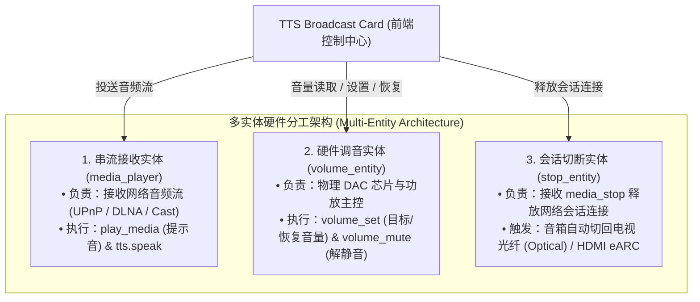

# TTS Broadcast Card (智能语音播报卡片)

<p align="center">
  <a href="https://github.com/hacs/default"></a>
  <a href="https://github.com/lucayunxiao/tts-broadcast-card/releases"></a>
  <a href="LICENSE"></a>
  
</p>

<p align="center">
  <b>Home Assistant Lovelace 现代极简、开箱即用的前端原生 TTS 广播卡片</b><br/>
  集成前置提示音过渡、交互式音量控制、硬件音量委托、智能释放 UPnP 会话切回电视光纤、微软 Edge TTS 多语种神经网络声线自适应、图形化 UI 表单配置与实时动态状态反馈。
</p>

<p align="center">
  <a href="README.md"><b>English</b></a> | <a href="README_zh.md"><b>简体中文</b></a>
</p>

---

## 📸 效果展示 (Preview)


<p align="center">
  
</p>

---

## ✨ 核心特性 (Features)

- ⚡ **零脚本即插即用（Zero-Script）**：100% 由卡片前端组件直接驱动 Home Assistant 核心服务，告别编写后台 YAML Script、自动化与复杂 Jinja 模板！
- 🔊 **卡片内置交互式音量控制（In-Card Volume Control）**：卡片表面直接集成音量胶囊按钮与平滑调节滑块，支持点击胶囊一键静音/还原，并按音箱实体在本地浏览器（`localStorage`）持久化记忆用户音量偏好。
- 🎛️ **硬件音量控制分离委托 (`volume_entity`)**：支持将播报媒体流与实体音箱硬件音量解耦。专为帝瓦雷 Devialet Phantom（Controller 主控实体 + Player UPnP 播放流实体）、KEF、Sonos 或功放等双实体架构量身定制。
- 🔈 **播报前智能自动解静音 (`auto_unmute`)**：在发送音量调节与播报指令前，主动向硬件实体发送 `media_player.volume_mute(is_volume_muted: false)`，确保重要提醒或安防告警绝不因昨夜静音而漏听。
- 🔁 **智能音量记忆与自动还原 (`restore_volume`)**：播报前精准捕获音箱当前音量与静音状态，在播报期间调用卡片滑块设定的大音量，播报完成后全自动恢复原始音量与原静音状态。内置多消息连续连发碰撞防丢锁，彻底避免后续语音覆盖真实初始音量。
- 🛑 **智能释放音频通道与会话 (`auto_stop`)**：彻底解决 DLNA/UPnP 播报后音箱会话持续占线、导致电视光纤（Optical TOSLink）或 HDMI eARC 无法自动切回的痛点。内置 `supported_features` 二进制位掩码嗅探（位 4096/2048 判断 STOP，位 1 判断 PAUSE），在保障 0 报错（杜绝 400 Bad Request）的同时安全释放音频通道。
- 🔔 **前置提示音（Notification Chime）**：支持在语音朗读前播放提示音或电台钟声，提供硬件缓冲延时滑动条（`chime_delay`），有效防止 DLNA、Chromecast、Sonos、HomePod 音箱在切换音频会话时吞字断音。
- 🌐 **微软 Edge TTS 多语言智能声线嗅探**：根据输入文本自动匹配高拟真度神经网络声线，无须人工繁琐配置：
  - 🇨🇳 中文 $\to$ `zh-CN-XiaoxiaoNeural`（晓晓）
  - 🇺🇸 英文 $\to$ `en-US-JennyNeural`（Jenny）
  - 🇯🇵 日文 $\to$ `ja-JP-NanamiNeural`（七海）
  - 🇰🇷 韩文 $\to$ `ko-KR-SunHiNeural`（善喜）
- 📱 **移动端响应式布局优化**：针对宽小于等于 480px 的手机屏幕自动应用紧凑胶囊与滑块布局，多设备无缝适应。
- ⚡ **输入法防误发与防重入管线**：完美支持中文/日文拼音与假名输入法（回车确认候选词绝不触发误广播），多消息异步版本号 (`_sessionId`) 机制防止连发冲突，超时熔断随文本长度动态自适应。
- 🎛️ **全图形化配置面板（GUI Visual Editor）**：利用原生 `<ha-form>` 构建 5 个折叠面板（基础配置、音量与声音控制、提示音配置、外观与图标、高级设置），无需手写 YAML。
- 🛡️ **实时状态指示与 18 秒安全熔断**：播报期间呈现呼吸光晕与声波徽标动画，自动监听播放器状态；内置 18 秒超时看门狗，防止因外部音箱状态异常导致按钮死锁。
- 🔄 **完备向下兼容**：保留对传统自定义脚本（Script Mode）与 `input_text` 文本同步接口的向下兼容支持。

---

## 📦 前置依赖建议 (Prerequisites)

### 🎙️ 微软 Edge TTS 自定义集成 (强烈推荐)

本卡片全面兼容 Home Assistant 的所有标准 TTS 实体（包括 `tts.piper`、`tts.google_translate`、`tts.cloud` 等），但**默认针对微软 Edge TTS 进行了专属深度优化**。

建议通过 HACS 安装知名的 [hass-edge-tts](https://github.com/hasscc/hass-edge-tts) 集成，即可在**无需付费订阅**的情况下，畅享微软云端高达 400+ 种媲美真人电台播音员质感的自然声线：

1. 进入 Home Assistant 的 **HACS** 商店。
2. 搜索 **Edge TTS** 并点击下载。
3. 重启 Home Assistant，在 **设置 > 设备与服务 > 添加集成** 中搜索并添加 **Edge TTS**。

> [!NOTE]
> 如果您希望使用 Piper 等本地离线引擎，只需在卡片图形界面的 **TTS 引擎实体** 下拉列表中选择对应的实体（如 `tts.piper`），卡片会自动优雅降级为通用 speak 协议。

---

## 🚀 安装指南 (Installation)

### 方式一：通过 HACS 商店安装 (推荐)

1. 打开 Home Assistant 左侧栏的 **HACS**。
2. 在搜索栏中直接搜索 `TTS Broadcast Card`。
3. 点击卡片并选择 **下载 (Download)**。
4. 刷新浏览器即可在仪表盘中添加并使用！

[](https://my.home-assistant.io/redirect/hacs_repository/?owner=lucayunxiao&repository=tts-broadcast-card&category=plugin)

> [!TIP]
> **针对 Lovelace YAML 模式 (`mode: yaml`) 用户**：  
> 若您的 Home Assistant 仪表盘配置为纯 YAML 代码模式，通过 HACS 下载后，请在 `ui-lovelace.yaml` 或 `configuration.yaml` 中添加以下资源引用，并重启 Home Assistant：
> ```yaml
> lovelace:
>   mode: yaml
>   resources:
>     - url: /hacsfiles/tts-broadcast-card/tts-broadcast-card.js
>       type: module
> ```

### 方式二：手动安装

1. 下载仓库最新发布的 [`dist/tts-broadcast-card.js`](https://raw.githubusercontent.com/lucayunxiao/tts-broadcast-card/main/dist/tts-broadcast-card.js)。
2. 将文件上传至 Home Assistant 的 `<config>/www/` 目录中。
3. 进入 **设置 > 仪表盘 > 右上角三点 > 资源**。
4. 点击 **添加资源**，URL 输入 `/local/tts-broadcast-card.js?v=1.1.0`，资源类型选择 `JavaScript 模块 (JavaScript Module)`。
5. 保存并硬刷新浏览器缓存（Ctrl+F5 或 Shift+刷新）。

---

## 🛠️ 卡片配置 (Configuration)

### 图形化配置面板 (Visual Editor)

<p align="center">
  
</p>

在仪表盘点击“添加卡片”，搜索并选择 **TTS Broadcast Card**，面板分为五个折叠层级：

1. **基础配置 (Core Settings)**：
   - `media_player`（必填）：目标广播音箱播放器实体。
   - `tts_entity`（可选）：TTS 引擎实体，默认自动推荐 `tts.edge_tts`。
   - `placeholder`（可选）：输入框提示文字（默认 `Message...`）。
2. **音量与声音控制 (Volume & Sound Control)**：
   - `volume_level`：默认广播音量滑动条（0% ~ 100%，步长 5，默认 40%）。
   - `show_volume_control`：卡片表面是否显示交互式音量胶囊与调节滑块开关。
   - `restore_volume`：播报完成后是否自动恢复播报前的原始音量与静音状态。
   - `volume_entity`（可选）：独立硬件音量实体（如外置功放或帝瓦雷主控实体）。
   - `auto_unmute`：播报前是否自动解除静音。
   - `auto_stop`：播报完成后是否自动停止/释放 UPnP 会话，以便恢复电视光纤音频。
   - `stop_entity`（可选）：用于 Auto-Stop 会话停止/释放的独立控制实体。
3. **提示音配置 (Notification Chime)**：
   - `chime_enabled`：提示音总开关（Toggle）。
   - `chime_url`：提示音音频链接（支持 `media-source://...`、`/local/...` 或外部 HTTP 音频）。
   - `chime_delay`：提示音与播报之间的缓冲时长（滑动条，0.5秒 ~ 10秒）。
4. **外观与图标 (Appearance & Icons)**：
   - `title` 与 `subtitle`：按钮主副标题。
   - `ready_color` 与 `active_color`：就绪态与播报态主题色（支持十六进制色号与 CSS 变量）。
   - `input_icon`、`button_icon`、`badge_icon`、`active_icon`：自定义 MDI 图标。
5. **高级设置 (Advanced Settings)**：
   - `script`：自定义后台广播脚本实体（覆盖原生流程）。
   - `input_text`：用于同步播报文本状态的文本实体。

---

### YAML 配置示例

```yaml
type: custom:tts-broadcast-card
media_player: media_player.living_room_player
volume_entity: media_player.living_room_controller # 可选：独立硬件主控/功放音量实体
volume_level: 45
show_volume_control: true
restore_volume: true # 可选：播报完毕后全自动恢复播报前的原始音量与静音
auto_unmute: true
auto_stop: true
tts_entity: tts.edge_tts
placeholder: "请输入广播内容..."
chime_enabled: true
chime_url: media-source://media_source/local/notification.mp3
chime_delay: 3.5
title: "广播"
subtitle: "客厅音箱"
ready_color: "#2196f3"
active_color: "#ff5722"
input_icon: mdi:comment-text-outline
button_icon: mdi:bullhorn
badge_icon: mdi:send
active_icon: mdi:volume-high
```

---

## 📋 配置参数详解 (Options Reference)

| 参数名 | 类型 | 默认值 | 详细说明 |
| :--- | :--- | :--- | :--- |
| `media_player` | string | **必填** | 目标音箱播放器实体 ID (`media_player.xxx`)。 |
| `tts_entity` | string | `tts.edge_tts` | TTS 引擎实体 ID。 |
| `placeholder` | string | `Message...` | 输入框空值提示占位符。 |
| `volume_level` | number | `40` | 默认广播音量百分比（0 - 100%）。 |
| `show_volume_control` | boolean | `true` | 是否在卡片表面显示交互式音量胶囊按钮与滑块。 |
| `restore_volume` | boolean | `false` | 播报完成后是否自动恢复播报前的原始音量及静音状态。 |
| `volume_entity` | string | *无* | 可选独立硬件音量控制实体（如外置功放或帝瓦雷主控实体）。音量读取/设置/恢复及静音状态均路由至此实体。 |
| `auto_unmute` | boolean | `true` | 播报前是否先向音箱发送解除静音指令。 |
| `auto_stop` | boolean | `true` | 播报结束后是否自动停止会话，以便音箱自动切回电视光纤音频。 |
| `stop_entity` | string | *无* | 可选独立的会话停止/释放控制实体（如数播/串流端）。避免向不支持停止指令的纯功放发指令报错，同时确保音箱恢复电视光纤/eARC。 |
| `chime_enabled` | boolean | `true` | 是否在播报前播放提示音。 |
| `chime_url` | string | `media-source://media_source/local/notification.mp3` | 提示声音频文件路径或网络直链。 |
| `chime_delay` | number | `3.5` | 提示音播放完毕后等待音箱清空缓冲的时长（秒）。 |
| `title` | string | `Broadcast` | 按钮主标题文字。 |
| `subtitle` | string | 播放器名称 | 按钮副标题文字（留空默认显示音箱友好名称）。 |
| `ready_color` | string | `#2196f3` | 就绪（空闲）态主题色。 |
| `active_color` | string | `#ff5722` | 正在播报时的脉冲与高亮主题色。 |
| `input_icon` | string | `mdi:comment-text-outline` | 文本框左侧图标。 |
| `button_icon` | string | `mdi:bullhorn` | 按钮空闲状态图标。 |
| `badge_icon` | string | `mdi:send` | 按钮右上角就绪角标图标。 |
| `active_icon` | string | `mdi:volume-high` | 播报中的声波主图标。 |
| `script` | string | *无* | 高级模式：可选自定义后台广播脚本实体（接管原生流水线）。自动向脚本传递 `message`（文本）与 `volume`（浮点数 0.0-1.0）变量。 |
| `input_text` | string | *无* | 高级模式：可选文本辅助实体（`input_text.xxx`），自动同步广播文本，用于仪表盘历史展示与下游自动化联动。 |

---

## 🎛️ 多实体音频架构 (`volume_entity` 与 `stop_entity`)

常规智能音箱（如 Google Nest、HomePod、小爱音箱）通常将音频串流、音量控制和会话生命周期集中在一个 `media_player` 实体中。

但在**高保真 Hi-Fi 音响、发烧级音箱（如帝瓦雷 Devialet Phantom、KEF）、家庭影院 AV 功放（天龙 Denon、雅马哈 Yamaha）或外置网络数播转盘（WiiM Pro、HiFiBerry）**中，Home Assistant 通常会将硬件拆分为**职责各异的独立实体**：



### 参数职责与解决痛点对照表

| 配置项 | 架构角色 | 解决的实际痛点（为什么必须独立设置？） |
| :--- | :--- | :--- |
| **`media_player`**<br/>*(必填)* | **音频投送端 (Streaming Receiver)** | 接收 TTS 和提示音音频流的网络端点（如 DLNA 渲染器或 Cast 接收端）。 |
| **`volume_entity`**<br/>*(可选)* | **硬件调音端 (Hardware Controller)** | **痛点**：串流端实体（如 DLNA DMR）往往不支持硬件调音，或者在串流端做数字衰减会损坏动态范围和音质；真正的硬件音量归功放主控实体管辖。<br/>**解决方案**：卡片读取初始音量、滑块设定、播报前解静音和播报后音量还原，全部**精准路由到硬件功放**。 |
| **`stop_entity`**<br/>*(可选)* | **会话释放端 (Session Stopper)** | **痛点**：播报结束后需要发送 `media_stop` 释放 UPnP 连接，以便音箱切回电视声音。若只配置了 `volume_entity`（如功放主控），默认会把 stop 发给功放；而**纯功放通常不支持 Stop 播放指令（会报 HTTP 400 Bad Request 错误）**！<br/>**解决方案**：通过将 `stop_entity` 指定为串流端，保证精准释放 UPnP 会话且 0 报错，触发音箱自动切回电视光纤。 |

### 典型真实硬件案例

#### 案例 A：帝瓦雷 Devialet Phantom / Arch 对箱系统（电视光纤无缝切换）
- **音频流接收端**：`media_player.devialet_upnp`（接收 UPnP 音频流）
- **硬件主控实体**：`media_player.devialet_controller`（官方集成，控制物理音量、电源与静音）
- **会话释放实体**：`media_player.devialet_upnp`（发送 `media_stop` 释放 UPnP 流，音箱秒切回电视光纤）

```yaml
type: custom:tts-broadcast-card
media_player: media_player.devialet_upnp          # 投送 TTS 与提示音频
volume_entity: media_player.devialet_controller   # 硬件音量与解静音
stop_entity: media_player.devialet_upnp           # 释放 UPnP 会话，音箱切回电视光纤
auto_stop: true
restore_volume: true
```

#### 案例 B：外部网络数播（WiiM / HiFiBerry）+ 家庭影院 AV 功放（天龙/雅马哈）
- **音频流接收端**：`media_player.wiim_pro_dlna`（WiiM 数播插在功放输入口）
- **硬件调音实体**：`media_player.denon_avr`（天龙功放主控，控制客厅真实总音量）
- **会话释放实体**：`media_player.wiim_pro_dlna`（播完停止 WiiM 的播放队列，避免天龙功放报 400 错误）

```yaml
type: custom:tts-broadcast-card
media_player: media_player.wiim_pro_dlna   # 音频推到 WiiM 数播
volume_entity: media_player.denon_avr      # 音量调整与解静音由天龙功放执行
stop_entity: media_player.wiim_pro_dlna    # 播完停止 WiiM 流
auto_unmute: true
restore_volume: true
```

---

## 🚀 高级自动化联动 (`script` 与 `input_text`)

高级设置（Advanced Settings）为高阶用户和自动化联动场景量身打造，将**优雅的前端交互界面**与**强大的 Home Assistant 后台自动化能力**深度解耦。

### 1. 同步消息文本实体 (`input_text`)

#### 作用原理：
每当用户在卡片中输入文本并按下回车或发送按钮时，卡片会自动调用 `input_text.set_value` 服务，把刚播报的文字**实时写入指定的 `input_text` 辅助实体**。

#### 解决的实际痛点与典型应用：
1. **播报历史与状态展示**：在仪表盘的其他位置，家庭成员可以通过普通 Markdown 卡片或实体卡片随时查看“最后一条广播讲了什么”，避免因当时不在音箱旁而漏看。
2. **下游联动自动化触发源 (Chaining Automations)**：利用 Home Assistant 自动化监听 `input_text` 状态变化：只要一广播，就同步给手机 App 发一条推送通知，或将文字同步显示到智能中控屏/墨水屏上。

#### 完整落地配置：

**第 1 步：在 HA 创建 Helper（设置 -> 设备与服务 -> 辅助元素 -> 创建辅助元素 -> 文本）**  
实体 ID：`input_text.last_broadcast_message`

**第 2 步：卡片配置绑定辅助实体**
```yaml
type: custom:tts-broadcast-card
media_player: media_player.living_room_speaker
input_text: input_text.last_broadcast_message # 🌟 绑定文本辅助实体
```

**第 3 步：下游自动化（广播时同步推送手机通知）**
```yaml
alias: "广播同步推送手机通知"
description: "当卡片发出广播时，将文本同步推送到家庭成员手机"
trigger:
  - platform: state
    entity_id: input_text.last_broadcast_message
condition:
  - condition: template
    value_template: "{{ trigger.to_state.state != '' }}"
action:
  - action: notify.notify
    data:
      title: "📢 家里刚刚发出了广播"
      message: "{{ states('input_text.last_broadcast_message') }}"
```

---

### 2. 自定义广播脚本代理 (`script`)

#### 作用原理：
默认情况下，卡片自带**零脚本 (Zero-Script)** 原生流水线（读取音量 -> 解静音 -> 调音量 -> 播提示音 -> 等待缓冲 -> 调用 Edge TTS -> 自动释放会话与恢复音量）。

当配置了 `script: script.my_broadcast` 时，卡片将**跳过自带的 TTS 流程，改为直接调用您的后台脚本**，并将以下两个参数通过 `data` **完整传递给脚本**：
- `message` (string)：卡片文本框中输入的广播文字。
- `volume` (float, `0.0` ~ `1.0`)：卡片滑块选择的目标广播音量小数。

#### 为什么有了卡片还需要用 `script`？
卡片为您提供了**极致美观的前端操作体验**（单行精致 UI、音量胶囊滑块、本地音量记忆、回车发送、移动端键盘防误触、状态呼吸灯动画）；  
而后台 `script` 则让您拥有**无上限的后端定制能力**：
- **多房间/全屋广播编队**（全家 5 个音箱一起响，且支持闪烁走廊吊灯提醒）。
- **音乐避让 (Audio Ducking)**（如果正在播放 Spotify，先暂停音乐 -> 广播完 -> 恢复播放音乐）。
- **夜间安静模式防扰**（若在晚上 10 点后，不播放音箱，改为发手机通知）。
- **自定义特殊 TTS 引擎**（如自行搭建的本地 Piper TTS 或 OpenAI TTS 私有接口）。

#### 完整落地配置：

**第 1 步：在 Home Assistant `scripts.yaml` 中编写自定义脚本**
```yaml
living_room_smart_broadcast:
  alias: "智能联动广播脚本"
  description: "接收卡片传递的 message 与 volume，实现闪灯与全屋播报"
  fields:
    message:
      description: "卡片输入的文字"
      example: "开饭啦！"
    volume:
      description: "卡片滑块选择的音量 (0.0 - 1.0)"
      example: 0.65
  sequence:
    # 步骤 1: 闪烁客厅氛围灯提醒
    - action: light.toggle
      target:
        entity_id: light.living_room_ambient
    # 步骤 2: 将音箱设置到卡片滑块选择的音量
    - action: media_player.volume_set
      target:
        entity_id: media_player.living_room_speaker
      data:
        volume_level: "{{ volume }}"
    # 步骤 3: 播放提示音
    - action: media_player.play_media
      target:
        entity_id: media_player.living_room_speaker
      data:
        media_content_id: media-source://media_source/local/bell.mp3
        media_content_type: music
    - delay: "00:00:02"
    # 步骤 4: 调用本地 Piper TTS 朗读卡片文字
    - action: tts.speak
      target:
        entity_id: tts.piper
      data:
        media_player_entity_id: media_player.living_room_speaker
        message: "{{ message }}"
    # 步骤 5: 同步推送到手机 App
    - action: notify.notify
      data:
        message: "广播通知：{{ message }}"
```

**第 2 步：卡片配置关联脚本**
```yaml
type: custom:tts-broadcast-card
media_player: media_player.living_room_speaker # 仍然指定主要音箱（用于状态监听）
script: script.living_room_smart_broadcast      # 🌟 接管播报管线，自动传递 message 和 volume
input_text: input_text.last_broadcast_message   # 可选：同步记录历史
```

---

## ❓ 常见问题与排错 (FAQ)

<details>
<summary><b>1. 为什么某些无线音箱偶尔会吞掉播报的第一句话？</b></summary>
DLNA、AirPlay 或 Chromecast 音箱从空闲启动到音频会话激活存在硬件唤醒延迟，若启用了前置提示音，不同音箱在切换音频轨时也需要缓冲区复位时间。建议在卡片设置中适当增大 <code>chime_delay</code>（例如调整至 3.5s ~ 4.5s），即可确保声音从容完整播放。
</details>

<details>
<summary><b>2. 为什么帝瓦雷 (Devialet) / Sonos 等音箱播报完无法自动切回电视光纤音频？</b></summary>
通过 UPnP/DLNA 播放 TTS 或提示音时，音箱在音频播放完后仍会保持流媒体会话连接状态，音箱的自动信源切换（Autoswitch）因此无法触发。开启 <code>auto_stop: true</code>（默认已开启）后，卡片会按文本字数智能估算时长，并在播报结束后自动发送停止/暂停指令释放 UPnP 会话，音箱即可瞬间无缝切回电视光纤（Optical）或 HDMI eARC 声音。
</details>

<details>
<summary><b>3. 如何配置双实体/多实体音响系统（如 Devialet Controller 与 UPnP Player）？</b></summary>
许多高端音箱或家庭影院在 Home Assistant 中包含两到三个实体：一个负责网络音频流播放（如 <code>media_player.devialet_player</code>），一个负责硬件主机音量控制（如 <code>media_player.devialet_controller</code>），以及会话停止目标。

在卡片配置中：
<ul>
  <li>将 <code>media_player</code> 设置为播放流实体（负责播放媒体流）。</li>
  <li>将 <code>volume_entity</code> 设置为硬件主控实体（负责读取音量、调音、解静音和音量恢复）。</li>
  <li>将 <code>stop_entity</code> 设置为播放流实体（确保 <code>media_stop</code> 精准释放 UPnP，避免纯功放报 400 Bad Request 错误）。</li>
</ul>
详细架构图解与配置示例请参见 <a href="#%EF%B8%8F-%E5%A4%9A%E5%AE%9E%E4%BD%93%E9%9F%B3%E9%A2%91%E6%9E%B6%E6%9E%84-volume_entity-%E4%B8%8E-stop_entity">多实体音频架构</a> 章节。
</details>

<details>
<summary><b>4. 如何使用本地的提示音音频？</b></summary>
将 mp3 音频上传至 Home Assistant 的 <b>媒体 > 本地媒体</b>，或放置在 <code>/config/www/notification.mp3</code>，在卡片配置的 <code>chime_url</code> 中填写 <code>media-source://media_source/local/notification.mp3</code> 或 <code>/local/notification.mp3</code> 即可。
</details>

<details>
<summary><b>5. 支持回车快捷发送吗？</b></summary>
支持！在电脑端输入文本后按下 <kbd>Enter</kbd> 键，或在手机虚拟键盘上按下 <kbd>发送</kbd> 按钮，均会自动触发广播并清空输入框。
</details>

<details>
<summary><b>6. 为什么 Google Cast / 智能音箱被成功唤醒（听到了连接拉起声），但随后没有发出任何语音？</b></summary>
这是 Google Cast 底层<b>“控制信令与媒体流拉取双通道分离”</b>的典型现象：
<ul>
  <li><b>通道一（控制信令 / Push）：</b>Home Assistant 通过 <code>TCP 8009</code> 端口主动向音箱发送指令唤醒播放器。只要您听到了音箱发出的“咚”拉起声，证明<b>该通道 100% 畅通</b>。</li>
  <li><b>通道二（媒体拉取 / Pull）：</b>音箱唤醒后，转由音箱自身主动向 Home Assistant 发起 HTTP/HTTPS GET 请求（如 <code>http://&lt;HA_IP&gt;/api/tts_proxy/...mp3</code>）下载音频流。</li>
</ul>
如果您听到拉起声后陷入死寂，说明<b>通道二在反向拉取时失败了</b>。请按以下重点排查：
<ol>
  <li><b>IoT VLAN 防火墙单向阻断（最常见）：</b>在划分了 VLAN 的网络中，防火墙通常允许 主网络 &rarr; IoT（所以能拉起音箱），但默认禁止 IoT &rarr; 主网络。当音箱反向请求音频时被防火墙拦截。<b>解决对策：</b>在路由器中配置防火墙规则，放行音箱访问 HA 主机的 <b>TCP 80、443、8123</b> 端口。</li>
  <li><b>Google 硬编码 DNS（8.8.8.8）：</b>Chromecast / Nest 固件在底层硬编码了 Google DNS（8.8.8.8），完全无视本地局域网分配的私有 DNS 服务器。如果 HA 的 <code>internal_url</code> 使用了 <code>.local</code> 或纯内网域名，音箱通过 8.8.8.8 根本无法解析。<b>解决对策：</b>确保 HA 的 <code>internal_url</code> 配置为<b>纯局域网 IP 地址</b>（如 <code>http://192.168.1.xxx</code>）或公网可解析域名。</li>
  <li><b>无线 AP 客户端隔离（Client Isolation）：</b>如果音箱与 HA 处于同一 Wi-Fi，确保路由器未开启 AP 隔离，否则无线设备之间无法进行内网通信。</li>
</ol>
</details>

<details>
<summary><b>7. 音量恢复机制 (<code>restore_volume</code>) 的运作原理是什么？</b></summary>
当卡片开启 <code>restore_volume: true</code> 后：
<ol>
  <li><b>播报前快照：</b>在卡片调整音量或解除静音的瞬间，首先读取音箱（或 <code>volume_entity</code>）当前的音量百分比与静音状态。</li>
  <li><b>目标播报：</b>调用卡片滑块选择的设定音量执行语音与提示音朗读。</li>
  <li><b>播报后还原：</b>播报完毕后（与计算出的文本发音耗时及 <code>auto_stop</code> 同步触发），卡片向实体发送指令恢复原始音量；若音箱原先处于静音状态，亦会自动重新恢复静音。</li>
  <li><b>连续广播碰撞保护：</b>若在前一条语音尚未播完时再次快速点击发送，卡片会自动锁定最初读取的真实音量，并顺延恢复定时器，避免将播报中的临时大音量误当成原始音量写入。</li>
</ol>
</details>

---

## 📄 开源许可证 (License)

本项目采用 [MIT 许可证](LICENSE) 开源。欢迎提交 Issue 或 Pull Request！
